# Database Architecture

StageTrack Enterprise targets **MySQL 8.0+** (InnoDB, `utf8mb4` / `utf8mb4_unicode_ci`) in production and **SQLite** for the automated test-suite. All schema is defined in `database/migrations/` and this document is derived from those files — if they disagree, the migrations win.

| Migration | Tables |
|---|---|
| `0001_01_01_000000_create_users_table` | `users`, `password_reset_tokens`, `sessions` |
| `0001_01_01_000001_create_cache_table` | `cache`, `cache_locks` |
| `0001_01_01_000002_create_jobs_table` | `jobs` (queue), `job_batches`, `failed_jobs` |
| `2025_01_01_000050_create_passkeys_table` | `passkeys` |
| `2025_01_01_000100_create_access_control_tables` | `permissions`, `roles`, `permission_role`, `role_user`, `audit_logs`, `settings` |
| `2025_01_01_000200_create_inventory_tables` | `locations`, `categories`, `manufacturers`, `products`, `product_images`, `product_accessories`, `tags`, `taggables`, `stock_levels`, `contacts` |
| `2025_01_01_000300_create_asset_and_maintenance_tables` | `assets`, `asset_status_history`, `condition_reports`, `maintenance_records` |
| `2025_01_01_000400_create_job_and_reservation_tables` | `production_jobs`, `job_items`, `job_item_assets`, `job_contacts`, `job_stage_history`, `reservations`, `notes`, `attachments` (+ FK `maintenance_records.job_id`) |
| `2025_01_01_000500_create_warehouse_tables` | `scan_events` |
| `2025_01_01_000600_create_customization_tables` | `custom_field_definitions`, `custom_field_values`, `validation_rules`, `document_templates`, `generated_documents`, `reports`, `report_schedules`, `search_index` |

---

## 1. Conventions

- **Primary keys**: `id` `BIGINT UNSIGNED AUTO_INCREMENT` (`$table->id()`), except pivot tables (composite PK) and framework tables keyed by string (`sessions`, `cache`, `password_reset_tokens`).
- **Foreign keys**: `{singular}_id` `BIGINT UNSIGNED` with real InnoDB constraints. Delete behaviour is chosen per relation:
  - `cascadeOnDelete` for owned children (e.g. `job_items` → `production_jobs`, `assets` → `products`).
  - `nullOnDelete` for optional references (owners, creators, locations, contacts) so history survives deletion of the referenced row.
- **Timestamps**: `created_at`/`updated_at` (`TIMESTAMP NULL`). Append-only log tables (`audit_logs`, `asset_status_history`, `job_stage_history`, `scan_events`) only have `created_at DEFAULT CURRENT_TIMESTAMP`.
- **Soft deletes** (`deleted_at`): `users`, `products`, `contacts`, `assets`, `production_jobs`. These business records are referenced by history, documents and reports; soft deletion keeps reports and audit trails intact. All other tables hard-delete.
- **Enumerations** are stored as short `VARCHAR` columns (not MySQL `ENUM`) backed by PHP enums (`JobStage`, `ReservationStatus`, `AssetStatus`, `MaintenanceStatus`, `TrackingType`, `CustomFieldType`). Adding a value never requires an `ALTER TABLE`.
- **JSON** columns (`JSON` on MySQL, `TEXT` on SQLite) hold flexible structures: settings values, report/rule definitions, template blocks, audit diffs, metadata.
- **Money** is `DECIMAL(12,2)`; weights `DECIMAL(10,3)`; custom-field numbers `DECIMAL(18,4)`.
- **Human-friendly numbers** are generated in model `creating` hooks: jobs `J-00001`, maintenance `MR-00001`, generated documents `D-000001`.
- **Polymorphic columns** (`*_type`, `*_id`) always store **morph aliases**, never class names (see §5).

---

## 2. Tables

Notation: **PK** primary key, **UQ** unique, **IX** index, **FK** foreign key (→ target, on-delete behaviour), `?` nullable.

### 2.1 Identity, access control & system

#### `users`
| Column | Type | Notes |
|---|---|---|
| id | bigint PK | |
| name | varchar(255) | |
| username | varchar(255)? UQ | login with username *or* email |
| email | varchar(255) UQ | |
| email_verified_at | timestamp? | |
| password | varchar(255) | cast `hashed` |
| is_super_admin | bool default 0 | bypasses all permission checks; set by setup wizard |
| is_active | bool default 1 | inactive users are signed out by `EnforceSecurityPolicy` |
| two_factor_secret | text? | **encrypted** (`encrypted` cast) TOTP secret |
| two_factor_recovery_codes | text? | **encrypted** array (`encrypted:array` cast) of *hashed* one-time recovery codes (`RecoveryCodes` service) |
| two_factor_confirmed_at | timestamp? | 2FA is active only when secret *and* confirmed_at are set |
| password_changed_at | timestamp? | drives `security.password_expiry_days` |
| last_login_at / last_login_ip | timestamp? / varchar(45)? | |
| failed_login_attempts | smallint unsigned default 0 | lockout counter |
| locked_until | timestamp? | lockout expiry |
| preferences | json? | theme, sidebar state, etc. |
| remember_token | varchar(100)? | |
| created_at, updated_at, deleted_at | | soft deletes |

#### `password_reset_tokens`
`email` PK, `token`, `created_at?`.

#### `sessions` (database session driver — enables "list / revoke other sessions")
| Column | Type | Notes |
|---|---|---|
| id | varchar(255) PK | |
| user_id | bigint? IX | |
| ip_address | varchar(45)? | |
| user_agent | text? | |
| payload | longtext | |
| last_activity | int IX | unix time |

#### `cache`, `cache_locks`
`key` PK, `value` mediumtext / `owner`, `expiration` int IX. Used when `CACHE_STORE=database`; the `file` store is used before installation.

#### `jobs`, `job_batches`, `failed_jobs` (Laravel queue)
Standard Laravel queue tables. **This is why production jobs live in `production_jobs`.** `jobs.queue` is indexed; `failed_jobs.uuid` is unique.

#### `passkeys` (laravel/passkeys)
| Column | Type | Notes |
|---|---|---|
| id | bigint PK | |
| user_id | bigint FK → users (cascade) IX | |
| name | varchar | user-visible label ("MacBook Touch ID") |
| credential_id | varchar UQ | WebAuthn credential id |
| credential | json | public key credential source |
| last_used_at | timestamp? | |
| timestamps | | |

#### `permissions`
| Column | Type | Notes |
|---|---|---|
| id | bigint PK | |
| key | varchar UQ | `module.resource.action`, e.g. `jobs.stages.approve` |
| module | varchar(64) IX | |
| resource | varchar(64) | |
| action | varchar(32) | view/create/edit/delete/export/approve/admin |
| label | varchar | |
| description | varchar? | |
| timestamps | | |

Rows are synchronised from `config/permissions.php` (see [PERMISSIONS.md](PERMISSIONS.md)).

#### `roles`
`id`, `name` UQ, `description?`, `color varchar(16)?`, `is_default bool` (assigned to newly created users), timestamps. **No roles are seeded** — administrators create them.

#### `permission_role`, `role_user`
Pivot tables with composite PKs (`role_id, permission_id`) and (`role_id, user_id`); both FKs cascade.

#### `audit_logs`
| Column | Type | Notes |
|---|---|---|
| id | bigint PK | |
| user_id | bigint? FK → users (null) | actor |
| event | varchar(64) IX | `created`, `updated`, `deleted`, `login`, `login.passkey`, `login.failed`, … |
| auditable_type / auditable_id | nullable morphs (IX) | subject (morph alias) |
| old_values / new_values | json? | attribute diff (hidden & excluded attributes stripped) |
| description | varchar? | |
| ip_address | varchar(45)? | |
| user_agent | varchar(512)? | |
| created_at | timestamp IX default now | append-only |

#### `settings`
`id`, `group varchar(64) IX`, `key varchar UQ` (`{group}.{name}`), `value json?`, timestamps. Read through `SettingsRepository` (cached forever under the cache key `stagetrack.settings`, flushed on write). Defaults when a key has never been saved:

| Key | Default |
|---|---|
| general.organization_name | `StageTrack Enterprise` |
| general.currency / timezone / date_format | `USD` / `UTC` / `M j, Y` |
| general.logo_path / general.address | null |
| general.default_job_duration_days | 3 |
| security.password_min_length | 12 |
| security.password_require_mixed | true (mixed case + numbers) |
| security.password_expiry_days | 0 (never) |
| security.require_two_factor | false |
| security.require_two_factor_for_admins | true |
| security.max_login_attempts / lockout_minutes | 5 / 15 |
| security.session_lifetime_minutes | 480 |
| security.allow_passkeys | true |
| warehouse.sound_enabled | true |
| warehouse.allow_over_pull | false |
| reservations.block_overbooking | true |
| reservations.count_tentative | false |

### 2.2 Inventory

#### `locations` (hierarchical: warehouse → room → shelf → bin; also venues & vehicles)
| Column | Type | Notes |
|---|---|---|
| id | bigint PK | |
| parent_id | bigint? FK → locations (null) | self-reference |
| name | varchar | |
| code | varchar(64)? UQ | |
| type | varchar(32) default `warehouse` | warehouse, room, shelf, bin, venue, vehicle |
| barcode | varchar(128)? UQ | scannable location labels |
| address, notes | text? | |
| is_active | bool default 1 | |
| timestamps | | |

#### `categories`
`id`, `parent_id?` FK → categories (null), `name`, `slug` UQ, `color?`, `icon?`, `sort_order uint`, timestamps.

#### `manufacturers`
`id`, `name` UQ, `website?`, timestamps.

#### `products` (product master — Current RMS *Product*)
| Column | Type | Notes |
|---|---|---|
| id | bigint PK | |
| name | varchar | |
| sku | varchar(64)? UQ | |
| category_id | bigint? FK → categories (null) | |
| manufacturer_id | bigint? FK → manufacturers (null) | |
| model | varchar? | |
| description | text? | |
| tracking | varchar(16) default `serialized` | `serialized` (assets) \| `bulk` (stock_levels) |
| replacement_cost, rental_price | decimal(12,2)? | |
| weight_kg | decimal(10,3)? | |
| barcode | varchar(128)? UQ | bulk items are scanned by product barcode |
| image_path | varchar? | primary image |
| default_location_id | bigint? FK → locations (null) | |
| metadata | json? | |
| is_active | bool default 1 | |
| timestamps, deleted_at | | soft deletes |

Indexes: composite `(category_id, is_active)` for catalogue browsing.

#### `product_images`
`id`, `product_id` FK (cascade), `path`, `caption?`, `sort_order`, timestamps.

#### `product_accessories` (accessories / kit components expanded on pull sheets)
| Column | Type | Notes |
|---|---|---|
| id | bigint PK | |
| product_id | FK → products (cascade) | parent |
| accessory_product_id | FK → products (cascade) | child |
| quantity | decimal(10,2) default 1 | **per parent unit** |
| type | varchar(16) default `required` | required \| optional \| safety \| consumable |
| auto_add | bool default 1 | automatically added as child `job_items` |
| notes | varchar? | |
| timestamps | | |

UQ `(product_id, accessory_product_id)`. Pull-sheet expansion: active = `ceil(quantity × required)`, spare = `ceil(quantity × spare)`.

#### `tags`, `taggables`
`tags`: `id`, `name` UQ, `slug` UQ, `color?`, timestamps. `taggables`: `tag_id` FK (cascade) + `taggable_type`/`taggable_id` morphs, composite PK `(tag_id, taggable_type, taggable_id)`. Tags drive rule scopes (e.g. every `moving-light` product needs PowerCON).

#### `stock_levels` (bulk stock per location)
| Column | Type | Notes |
|---|---|---|
| id | bigint PK | |
| product_id | FK → products (cascade) | |
| location_id | bigint? FK → locations (null) | null = unassigned |
| quantity | uint default 0 | owned units at location |
| quantity_maintenance / quantity_damaged / quantity_lost | uint default 0 | unserviceable buckets (subset of quantity) |
| timestamps | | |

UQ `(product_id, location_id)`.

#### `contacts` (people & organizations — Current RMS *Members*)
`id`, `type varchar(16)` (`person` \| `organization`), `organization_id?` FK → contacts (null), `name`, `email? IX`, `phone?`, `title?`, `address?`, `notes?`, timestamps, `deleted_at`.

### 2.3 Assets & maintenance

#### `assets` (serialized units — Current RMS *serialised stock*)
| Column | Type | Notes |
|---|---|---|
| id | bigint PK | |
| product_id | FK → products (cascade) | |
| asset_number | varchar(64) UQ | e.g. `LX-0042` |
| serial_number | varchar(128)? IX | manufacturer serial |
| barcode | varchar(128)? UQ | |
| status | varchar(24) IX default `available` | `AssetStatus`: available, allocated, checked_out, maintenance, damaged, lost, retired |
| condition | varchar(24) default `good` | new, good, fair, poor |
| location_id | bigint? FK → locations (null) | |
| purchased_at, warranty_expires_at | date? | |
| purchase_cost | decimal(12,2)? | |
| notes | text? | |
| metadata | json? | |
| timestamps, deleted_at | | soft deletes |

Indexes: `(product_id, status)` — hot path of the availability calculator (count by status per product). Scanners may produce `barcode`, `asset_number` or `serial_number`; all three resolve (`Asset::scanCodes()`).

#### `asset_status_history`
`id`, `asset_id` FK (cascade), `from_status?`, `to_status`, `location_id?` FK (null), `context_type/context_id` nullable morphs (job, maintenance record, …), `user_id?` FK (null), `notes?`, `created_at`.

#### `condition_reports`
`id`, `asset_id` FK (cascade), `condition`, `notes?`, `photos json?`, `reported_by?` FK → users (null), timestamps.

#### `maintenance_records`
| Column | Type | Notes |
|---|---|---|
| id | bigint PK | |
| reference | varchar(32) UQ | `MR-00001` |
| product_id | FK → products (cascade) | |
| asset_id | bigint? FK → assets (null) | null for bulk |
| quantity | uint default 1 | bulk units affected |
| type | varchar(24) default `repair` | repair, inspection, pat_test, cleaning, damage, calibration |
| status | varchar(24) IX default `open` | `MaintenanceStatus`: open, in_progress, awaiting_parts (active) / completed, written_off |
| priority | varchar(16) default `normal` | |
| title | varchar | |
| description, resolution | text? | |
| cost | decimal(12,2)? | |
| job_id | bigint? FK → production_jobs (null) | job during which damage occurred (FK added in migration 000400) |
| assigned_to, reported_by | bigint? FK → users (null) | |
| due_at, started_at, completed_at | timestamp? | |
| timestamps | | |

Active maintenance records are an availability source (bucket `maintenance`).

### 2.4 Jobs & reservations

#### `production_jobs` (Current RMS *Opportunity / Order*)
| Column | Type | Notes |
|---|---|---|
| id | bigint PK | |
| number | varchar(32) UQ | `J-00001` |
| name | varchar | "Spring Musical — Into the Woods" |
| stage | varchar(24) IX default `inquiry` | `JobStage` (11 stages) |
| workflow_status | varchar(64)? | free-form secondary status |
| client_contact_id | bigint? FK → contacts (null) | |
| venue_location_id | bigint? FK → locations (null) | |
| owner_id | bigint? FK → users (null) | |
| prep_starts_at, starts_at, ends_at, returns_at | timestamp? | hold window = `prep_starts_at ?? starts_at` → `returns_at ?? ends_at` |
| description | text? | |
| color | varchar(16)? | calendar colour |
| timestamps, deleted_at | | soft deletes |

Indexes: `stage`, `(starts_at, returns_at)` for calendars and date-range reports.

#### `job_items` (allocations / line items)
| Column | Type | Notes |
|---|---|---|
| id | bigint PK | |
| job_id | FK → production_jobs (cascade) | |
| product_id | FK → products (cascade) | |
| parent_item_id | bigint? FK → job_items (cascade) | accessory lines point at the parent line |
| section | varchar? | "FOH Lighting", "Band Audio" |
| required_quantity | uint default 0 | **active** units needed |
| spare_quantity | uint default 0 | spares to pull |
| picked_quantity, checked_out_quantity, returned_quantity | uint default 0 | warehouse progress |
| unit_price | decimal(12,2)? | |
| notes | varchar? | |
| sort_order | uint default 0 | |
| timestamps | | |

Computed: `pull_quantity = required_quantity + spare_quantity` (`JobItem::getPullQuantityAttribute`).

#### `job_item_assets` (serialized units allocated to a line)
`id`, `job_item_id` FK (cascade), `asset_id` FK (cascade), `role varchar(16)` (`active` \| `spare`), `status varchar(24)` (allocated, picked, prepped, staged, checked_out, returned, damaged, missing), `checked_out_by?`/`returned_by?` FK → users (null), `checked_out_at?`, `returned_at?`, timestamps. UQ `(job_item_id, asset_id)`.

#### `job_contacts`
`id`, `job_id` FK → production_jobs (cascade), `contact_id` FK (cascade), `role?`, timestamps.

#### `job_stage_history`
`id`, `job_id` FK (cascade), `from_stage?`, `to_stage`, `user_id?` FK (null), `notes?`, `created_at`.

#### `reservations` — the single source of availability holds
| Column | Type | Notes |
|---|---|---|
| id | bigint PK | |
| product_id | FK → products (cascade) | |
| job_id | bigint? FK → production_jobs (cascade) | null = standalone hold (class use, rehearsal, loan) |
| job_item_id | bigint? FK → job_items (cascade) | one reservation per job line |
| name | varchar? | label for standalone holds |
| quantity | uint default 0 | active units |
| spare_quantity | uint default 0 | spares (also held) |
| starts_at, ends_at | timestamp | half-open interval `[starts_at, ends_at)` |
| status | varchar(16) IX default `confirmed` | tentative \| confirmed \| released |
| created_by | bigint? FK → users (null) | |
| notes | text? | |
| timestamps | | |

Indexes: `status`, `(product_id, starts_at, ends_at)` — supports the overlap predicate `starts_at < :to AND ends_at > :from` (`Reservation::scopeOverlapping`) combined with `scopeHolding` (`status IN ('confirmed','tentative')`).

#### `notes`, `attachments` (polymorphic; used by jobs, contacts, maintenance)
`notes`: `id`, `notable_type/notable_id` morphs, `user_id?`, `body text`, `is_pinned`, timestamps.
`attachments`: `id`, `attachable` morphs, `user_id?`, `disk` (default `local`), `path`, `original_name`, `mime_type?`, `size bigint`, timestamps.

### 2.5 Warehouse

#### `scan_events`
| Column | Type | Notes |
|---|---|---|
| id | bigint PK | |
| mode | varchar(16) IX | pick, prep, stage, checkout, return, damage, lookup |
| code | varchar(191) | raw scanned value |
| result | varchar(16) | success \| warning \| error |
| message | varchar | message shown to the operator |
| job_id, asset_id, product_id, location_id | bigint? FK (null) | resolved context |
| quantity | uint default 1 | |
| station | varchar(64)? | scanner / display station id |
| user_id | bigint? FK (null) | |
| created_at | timestamp IX | |

### 2.6 Customization, documents, reporting, search

#### `custom_field_definitions`
| Column | Type | Notes |
|---|---|---|
| id | bigint PK | |
| entity_type | varchar(64) IX | product, asset, job, reservation, document, contact, maintenance, location |
| key | varchar(64) | machine key, UQ per entity_type |
| label | varchar | |
| type | varchar(24) | `CustomFieldType` (14 types) |
| group | varchar? | form section |
| help_text | varchar? | |
| options | json? | dropdown choices, relation target, currency code |
| validation | json? | min, max, regex, … |
| is_required, show_in_list, is_searchable | bool | |
| sort_order | uint | |
| timestamps | | |

UQ `(entity_type, key)`.

#### `custom_field_values`
| Column | Type | Used by types |
|---|---|---|
| id | bigint PK | |
| definition_id | FK → custom_field_definitions (cascade) | |
| entity_type / entity_id | morphs | |
| value_text | text? | text, long_text, dropdown, url |
| value_number | decimal(18,4)? | number, currency, user, asset |
| value_date | datetime? | date, datetime |
| value_json | json? | checkbox, multi_select, relation, file |
| timestamps | | |

UQ `(definition_id, entity_type, entity_id)`; IX `(definition_id, value_number)` so reports can filter/aggregate numeric custom fields efficiently. Column choice is `CustomFieldType::storageColumn()`.

#### `validation_rules`
`id`, `name`, `description?`, `severity varchar(16)` (info \| warning \| error), `is_active`, `definition json` (see [MODULES.md › Rules](MODULES.md#rules)), `created_by?` FK (null), timestamps.

#### `document_templates`
| Column | Type | Notes |
|---|---|---|
| id | bigint PK | |
| name | varchar | |
| type | varchar(32) IX | one of 13 document types |
| entity_type | varchar(32) default `job` | context the template renders against |
| editor | varchar(16) default `visual` | visual \| code |
| blocks | json? | visual editor block list |
| html, css | longtext? | code-editor source |
| paper_size | varchar(16) default `letter` | letter, a4, legal |
| orientation | varchar(16) default `portrait` | portrait \| landscape |
| watermark | varchar? | e.g. `DRAFT` |
| is_default | bool | default template per type |
| version | uint default 1 | bumped on each save |
| updated_by | bigint? FK → users (null) | |
| timestamps | | |

#### `generated_documents` (immutable snapshots)
`id`, `number varchar(32) UQ` (`D-000001`), `template_id?` FK (null), `type`, `documentable` morphs, `title`, `html longtext` (rendered snapshot; hidden from serialization), `pdf_path?`, `created_by?` FK (null), timestamps.

#### `reports`
`id`, `name`, `description?`, `source varchar(32)` (ReportSourceRegistry key), `definition json`, `is_shared bool default 1`, `role_ids json?` (null = everyone with `reporting.reports.view`), `show_on_dashboard bool`, `created_by?` FK (null), timestamps.

#### `report_schedules`
`id`, `report_id` FK (cascade), `frequency` (daily \| weekly \| monthly), `format` (csv \| xlsx \| pdf), `recipients json`, `hour tinyint default 7`, `day_of_week tinyint?`, `day_of_month tinyint?` (capped at 28 by `computeNextRun`), `last_run_at?`, `next_run_at? IX`, `is_active`, timestamps.

#### `search_index`
| Column | Type | Notes |
|---|---|---|
| id | bigint PK | |
| entity_type | varchar(32) | morph alias |
| entity_id | bigint unsigned | |
| title | varchar IX | |
| subtitle | varchar? | |
| keywords | text? | |
| codes | varchar(512)? | space-separated barcodes, serials, asset/job numbers (exact match) |
| url | varchar | |
| timestamps | | |

UQ `(entity_type, entity_id)`. **MySQL only**: `FULLTEXT search_index_fulltext (title, subtitle, keywords, codes)`.

---

## 3. Indexing & performance strategy

| Query | Supporting index | Target |
|---|---|---|
| Overlapping holds for product(s) in a window | `reservations (product_id, starts_at, ends_at)` + `status` | Availability < 300 ms @ 50k assets |
| Asset counts by status per product | `assets (product_id, status)` | covered aggregate `COUNT(*) GROUP BY product_id, status` |
| Bulk buckets | `stock_levels UQ (product_id, location_id)` | |
| Active maintenance | `maintenance_records (status)` + FK `product_id` | |
| Exact code lookup (scanner) | `assets.barcode` UQ, `assets.asset_number` UQ, `assets.serial_number` IX, `products.barcode` UQ, `locations.barcode` UQ | < 50 ms server time per scan |
| Global search | FULLTEXT on `search_index` (MySQL), `title` IX | < 150 ms |
| Job calendars & reports | `production_jobs (starts_at, returns_at)`, `stage` | |
| Audit browsing | `audit_logs (created_at)`, `(event)`, morph IX | |
| Due report schedules | `report_schedules (next_run_at)` | |
| Custom-field reports | `custom_field_values (definition_id, value_number)` | |

Guidelines:

1. **Batch availability**: the Availability Explorer and job conflict checks load buckets and holds for *all requested products in one query per source* (`whereIn('product_id', …)`) and feed the pure `AvailabilityCalculator` in memory — no N+1.
2. **Eager loading** is mandatory on list pages; Inertia props are paginated.
3. **Append-only logs** (`scan_events`, `audit_logs`) are never updated; they can be pruned by date.
4. Report queries are built only from whitelisted columns via the query builder (parameter bindings) and capped by `limit`.
5. The settings table is read once per request from cache.

## 4. MySQL 8 specifics

- Charset/collation `utf8mb4` / `utf8mb4_unicode_ci` (Laravel default) — full Unicode including emoji in notes.
- The `FULLTEXT` index on `search_index` is created only when the driver is `mysql`; queries use `MATCH(title, subtitle, keywords, codes) AGAINST(? IN BOOLEAN MODE)` with prefix wildcards. Other drivers (SQLite in tests) fall back to `LIKE`.
- `JSON` columns are native on MySQL; StageTrack never relies on JSON path indexes, so SQLite/MariaDB remain compatible.
- `TIMESTAMP` columns are stored in UTC; the organisation timezone (`general.timezone`) is applied for display.
- InnoDB foreign keys are enforced; the restore engine disables `FOREIGN_KEY_CHECKS` while replaying a dump.
- Optional server tuning: `innodb_ft_min_token_size=2` so short codes (e.g. "LX") are FULLTEXT-indexable; codes are also matched exactly via `LIKE` on `codes`, so this is not required.

## 5. Morph map

Polymorphic relations use aliases enforced in `App\Providers\AppServiceProvider` via `Relation::enforceMorphMap` (persisting an unmapped class throws):

| Alias | Model |
|---|---|
| `user` | `App\Models\User` |
| `role` | `App\Domain\Authentication\Models\Role` |
| `product` | `App\Domain\Inventory\Models\Product` |
| `location` | `App\Domain\Inventory\Models\Location` |
| `asset` | `App\Domain\Assets\Models\Asset` |
| `contact` | `App\Domain\Contacts\Models\Contact` |
| `job` | `App\Domain\Jobs\Models\ProductionJob` |
| `reservation` | `App\Domain\Reservations\Models\Reservation` |
| `maintenance` | `App\Domain\Maintenance\Models\MaintenanceRecord` |
| `document` | `App\Domain\Documents\Models\GeneratedDocument` |
| `document_template` | `App\Domain\Documents\Models\DocumentTemplate` |
| `report` | `App\Domain\Reporting\Models\Report` |
| `rule` | `App\Domain\Rules\Models\ValidationRule` |
| `audit` | `App\Domain\Administration\Models\AuditLog` |
| `custom_field` | `App\Domain\CustomFields\Models\CustomFieldDefinition` |

These aliases are the `entity_type` values in `custom_field_definitions`, `custom_field_values` and `search_index`, and the `type` of availability sources.

## 6. Model traits touching the database

| Trait | Effect | Used by |
|---|---|---|
| `Auditable` | writes `audit_logs` on created/updated/deleted (hidden + `$auditExclude` attributes stripped; no-op updates skipped) | User, Role, Product, Asset, Location, Contact, ProductionJob, Reservation, MaintenanceRecord, DocumentTemplate, Report, ValidationRule, CustomFieldDefinition |
| `Searchable` | upserts/deletes `search_index` rows from `toSearchEntry()` | Product, Asset, Location, Contact, ProductionJob, Reservation (standalone only), MaintenanceRecord, GeneratedDocument, Report |
| `HasCustomFields` | `customFieldValues()` morphMany, `customFields()`, `setCustomFields()` | Product, Asset, Location, Contact, ProductionJob, Reservation, MaintenanceRecord, GeneratedDocument |
| `HasNotesAndAttachments` | `notes()`, `attachments()` morphMany | ProductionJob, Contact, MaintenanceRecord |

## 7. Entity-relationship diagram

```mermaid
erDiagram
    users ||--o{ role_user : has
    roles ||--o{ role_user : has
    roles ||--o{ permission_role : grants
    permissions ||--o{ permission_role : granted
    users ||--o{ passkeys : owns
    users ||--o{ sessions : has
    users ||--o{ audit_logs : performs

    locations ||--o{ locations : parent
    categories ||--o{ categories : parent
    categories ||--o{ products : classifies
    manufacturers ||--o{ products : makes
    locations ||--o{ products : default_location
    products ||--o{ product_images : has
    products ||--o{ product_accessories : parent
    products ||--o{ product_accessories : accessory
    tags ||--o{ taggables : tags
    products ||--o{ stock_levels : bulk_stock
    locations ||--o{ stock_levels : holds
    contacts ||--o{ contacts : organization

    products ||--o{ assets : instances
    locations ||--o{ assets : stores
    assets ||--o{ asset_status_history : history
    assets ||--o{ condition_reports : reports
    users ||--o{ condition_reports : reported_by
    products ||--o{ maintenance_records : for_product
    assets ||--o{ maintenance_records : for_asset
    production_jobs ||--o{ maintenance_records : caused
    users ||--o{ maintenance_records : assigned

    contacts ||--o{ production_jobs : client
    locations ||--o{ production_jobs : venue
    users ||--o{ production_jobs : owner
    production_jobs ||--o{ job_items : allocates
    products ||--o{ job_items : allocated
    job_items ||--o{ job_items : accessory_of
    job_items ||--o{ job_item_assets : assigns
    assets ||--o{ job_item_assets : assigned
    production_jobs ||--o{ job_contacts : has
    contacts ||--o{ job_contacts : linked
    production_jobs ||--o{ job_stage_history : history
    products ||--o{ reservations : held
    production_jobs ||--o{ reservations : generates
    job_items ||--o| reservations : holds
    users ||--o{ reservations : created_by

    production_jobs ||--o{ scan_events : scanned_for
    assets ||--o{ scan_events : scanned
    products ||--o{ scan_events : scanned_product
    locations ||--o{ scan_events : at
    users ||--o{ scan_events : by

    custom_field_definitions ||--o{ custom_field_values : values
    document_templates ||--o{ generated_documents : renders
    reports ||--o{ report_schedules : schedules
    users ||--o{ validation_rules : created_by
    users ||--o{ reports : created_by

    users {
        bigint id PK
        string username UK
        string email UK
        bool is_super_admin
        bool is_active
        text two_factor_secret
        timestamp locked_until
        json preferences
    }
    roles {
        bigint id PK
        string name UK
        bool is_default
    }
    permissions {
        bigint id PK
        string key UK
        string module
        string resource
        string action
    }
    permission_role {
        bigint role_id PK
        bigint permission_id PK
    }
    role_user {
        bigint role_id PK
        bigint user_id PK
    }
    passkeys {
        bigint id PK
        bigint user_id FK
        string credential_id UK
        json credential
    }
    sessions {
        string id PK
        bigint user_id
        int last_activity
    }
    audit_logs {
        bigint id PK
        bigint user_id FK
        string event
        string auditable_type
        bigint auditable_id
        json old_values
        json new_values
    }
    settings {
        bigint id PK
        string group
        string key UK
        json value
    }
    locations {
        bigint id PK
        bigint parent_id FK
        string code UK
        string type
        string barcode UK
    }
    categories {
        bigint id PK
        bigint parent_id FK
        string slug UK
    }
    manufacturers {
        bigint id PK
        string name UK
    }
    products {
        bigint id PK
        string sku UK
        bigint category_id FK
        bigint manufacturer_id FK
        string tracking
        string barcode UK
        bigint default_location_id FK
        decimal rental_price
    }
    product_images {
        bigint id PK
        bigint product_id FK
        string path
    }
    product_accessories {
        bigint id PK
        bigint product_id FK
        bigint accessory_product_id FK
        decimal quantity
        string type
        bool auto_add
    }
    tags {
        bigint id PK
        string slug UK
    }
    taggables {
        bigint tag_id PK
        string taggable_type PK
        bigint taggable_id PK
    }
    stock_levels {
        bigint id PK
        bigint product_id FK
        bigint location_id FK
        int quantity
        int quantity_maintenance
        int quantity_damaged
        int quantity_lost
    }
    contacts {
        bigint id PK
        string type
        bigint organization_id FK
        string email
    }
    assets {
        bigint id PK
        bigint product_id FK
        string asset_number UK
        string serial_number
        string barcode UK
        string status
        bigint location_id FK
    }
    asset_status_history {
        bigint id PK
        bigint asset_id FK
        string from_status
        string to_status
        string context_type
        bigint context_id
    }
    condition_reports {
        bigint id PK
        bigint asset_id FK
        string condition
        bigint reported_by FK
    }
    maintenance_records {
        bigint id PK
        string reference UK
        bigint product_id FK
        bigint asset_id FK
        int quantity
        string status
        bigint job_id FK
    }
    production_jobs {
        bigint id PK
        string number UK
        string stage
        bigint client_contact_id FK
        bigint venue_location_id FK
        bigint owner_id FK
        timestamp prep_starts_at
        timestamp starts_at
        timestamp ends_at
        timestamp returns_at
    }
    job_items {
        bigint id PK
        bigint job_id FK
        bigint product_id FK
        bigint parent_item_id FK
        int required_quantity
        int spare_quantity
        int picked_quantity
        int checked_out_quantity
        int returned_quantity
    }
    job_item_assets {
        bigint id PK
        bigint job_item_id FK
        bigint asset_id FK
        string role
        string status
    }
    job_contacts {
        bigint id PK
        bigint job_id FK
        bigint contact_id FK
        string role
    }
    job_stage_history {
        bigint id PK
        bigint job_id FK
        string from_stage
        string to_stage
    }
    reservations {
        bigint id PK
        bigint product_id FK
        bigint job_id FK
        bigint job_item_id FK
        int quantity
        int spare_quantity
        timestamp starts_at
        timestamp ends_at
        string status
    }
    notes {
        bigint id PK
        string notable_type
        bigint notable_id
        text body
    }
    attachments {
        bigint id PK
        string attachable_type
        bigint attachable_id
        string path
    }
    scan_events {
        bigint id PK
        string mode
        string code
        string result
        bigint job_id FK
        bigint asset_id FK
        bigint product_id FK
        bigint location_id FK
        bigint user_id FK
    }
    custom_field_definitions {
        bigint id PK
        string entity_type
        string key
        string type
    }
    custom_field_values {
        bigint id PK
        bigint definition_id FK
        string entity_type
        bigint entity_id
        text value_text
        decimal value_number
        datetime value_date
        json value_json
    }
    validation_rules {
        bigint id PK
        string severity
        json definition
        bigint created_by FK
    }
    document_templates {
        bigint id PK
        string type
        string editor
        json blocks
        longtext html
        int version
    }
    generated_documents {
        bigint id PK
        string number UK
        bigint template_id FK
        string documentable_type
        bigint documentable_id
        longtext html
    }
    reports {
        bigint id PK
        string source
        json definition
        json role_ids
        bigint created_by FK
    }
    report_schedules {
        bigint id PK
        bigint report_id FK
        string frequency
        string format
        timestamp next_run_at
    }
    search_index {
        bigint id PK
        string entity_type
        bigint entity_id
        string title
        string codes
        string url
    }
```

Polymorphic relations not drawn as edges: `audit_logs.auditable`, `asset_status_history.context`, `taggables.taggable`, `notes.notable`, `attachments.attachable`, `custom_field_values.entity`, `generated_documents.documentable`, `search_index.entity`. Framework tables (`cache`, `cache_locks`, `jobs`, `job_batches`, `failed_jobs`, `password_reset_tokens`) are omitted from the diagram.
