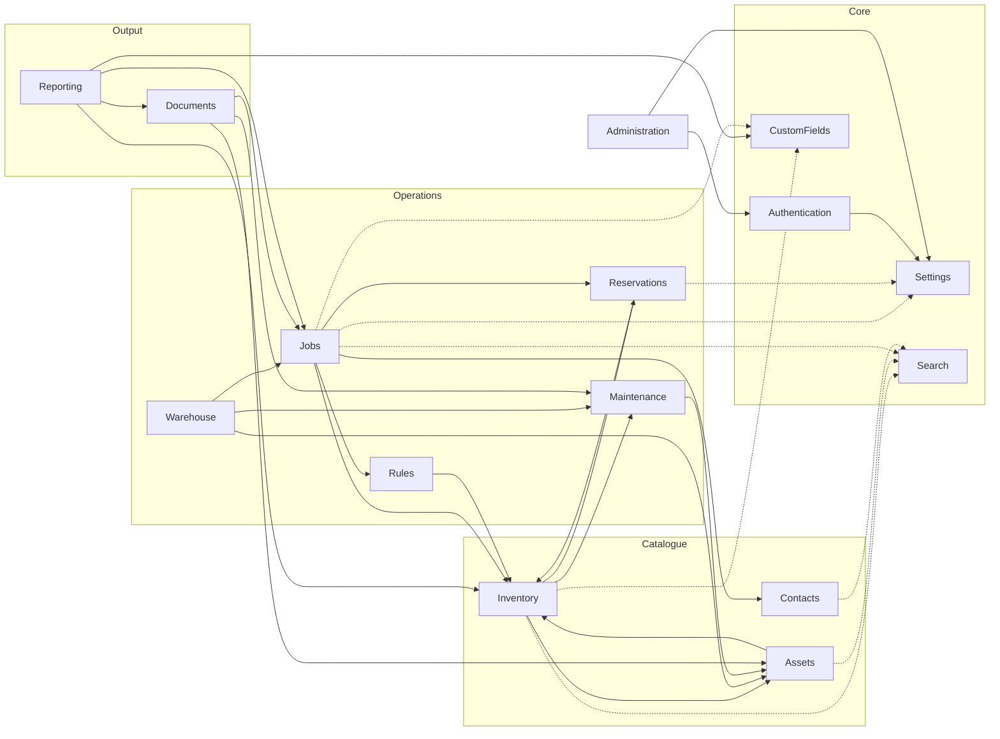
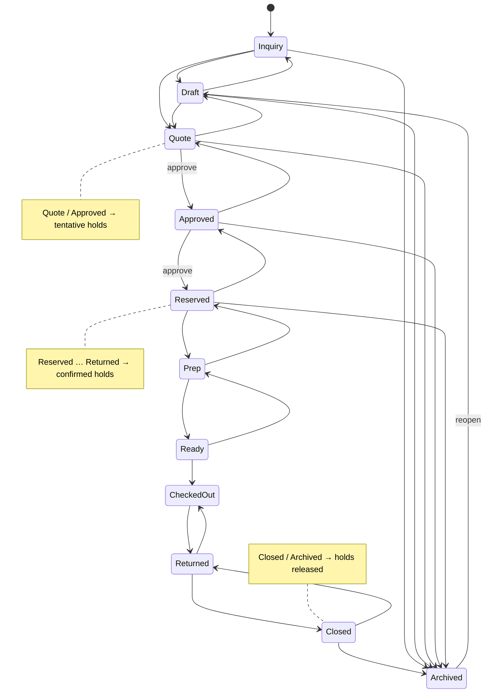
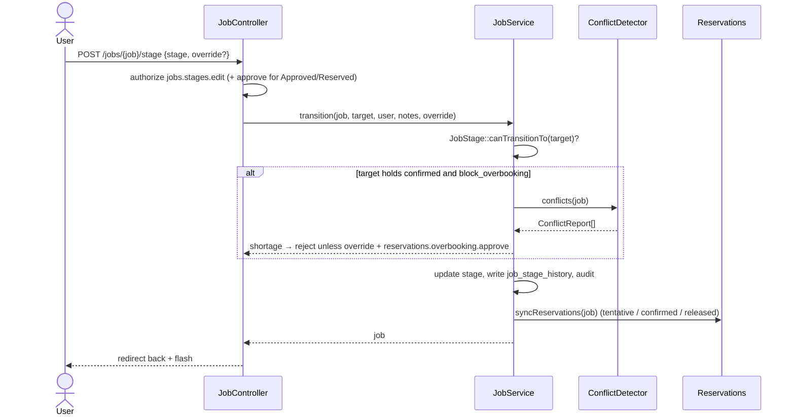
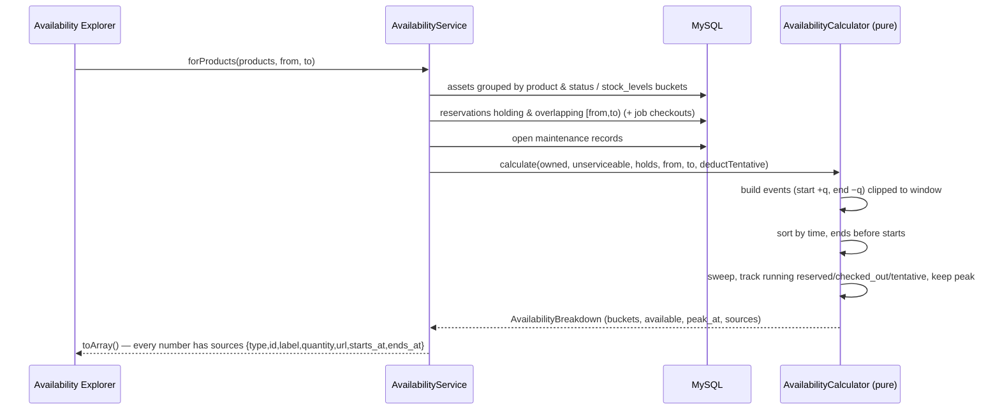
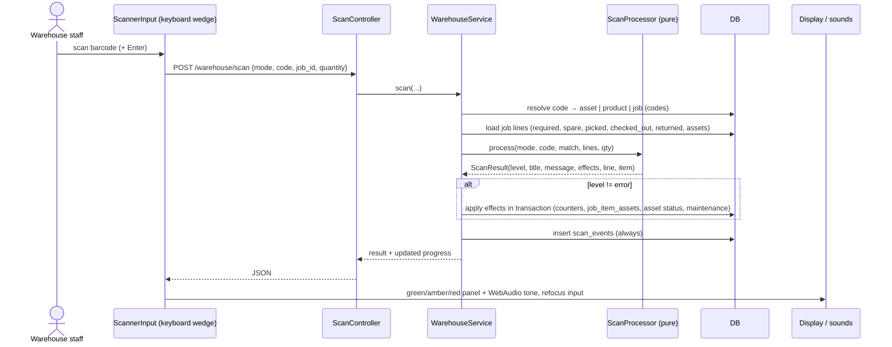
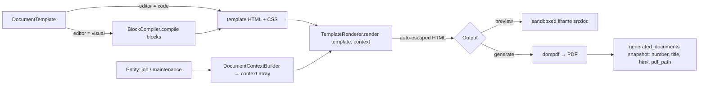
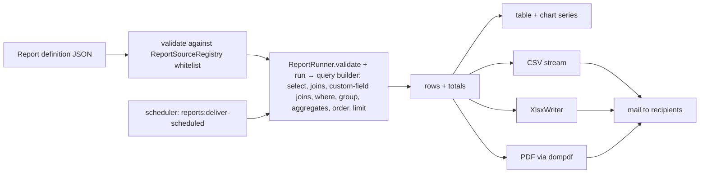
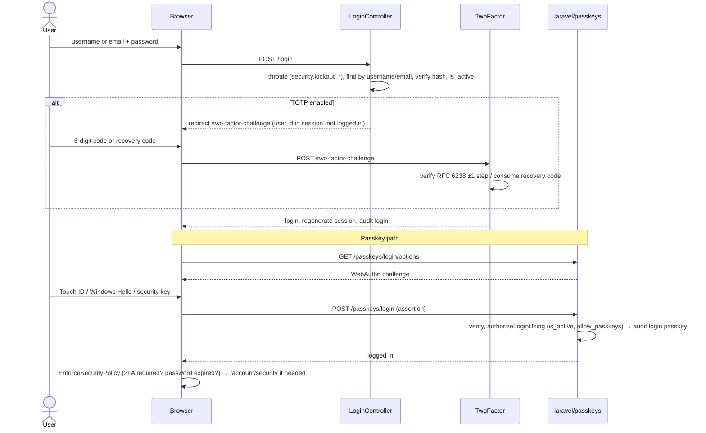
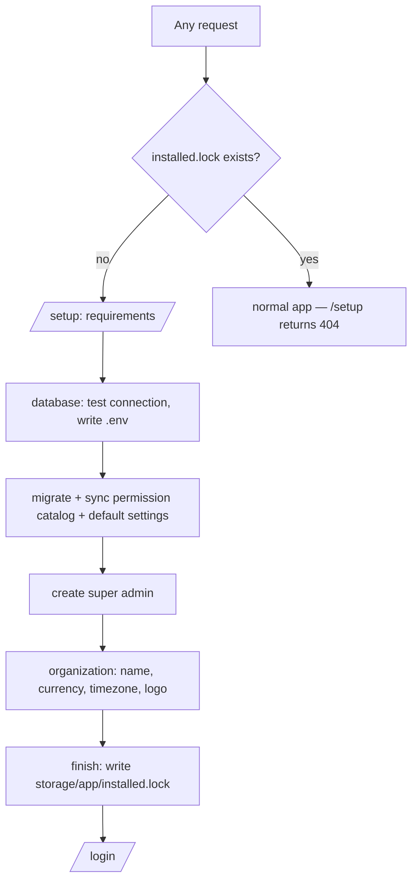

# Module Map

StageTrack is a Laravel monolith split into **domain modules** under `app/Domain/{Module}` (see [ADR-002](DECISIONS.md#adr-002--domain-modules-under-appdomainmodule)). This document describes each module's responsibilities, key classes, pages and permissions, and the main workflows.

> Classes marked † exist in the codebase at the time of writing; others describe the agreed design and the names they are expected to have. Always treat the code as authoritative.

## Contents

- [Module layout](#module-layout)
- [Dependency graph](#dependency-graph)
- [Modules](#modules): [Inventory](#inventory) · [Assets](#assets) · [Contacts](#contacts) · [Jobs](#jobs) · [Reservations](#reservations) · [Warehouse](#warehouse) · [Maintenance](#maintenance) · [Rules](#rules) · [Documents](#documents) · [Reporting](#reporting) · [CustomFields](#customfields) · [Search](#search) · [Authentication](#authentication) · [Administration](#administration) · [Settings](#settings)
- [Workflows](#workflows): [Job lifecycle](#job-lifecycle) · [Availability computation](#availability-computation) · [Scan flow](#scan-flow) · [Document render pipeline](#document-render-pipeline) · [Report run pipeline](#report-run-pipeline) · [Login with 2FA / passkey](#login-with-2fa--passkey) · [Setup wizard](#setup-wizard)

## Module layout

```text
app/Domain/{Module}/
├── Console/            # Artisan commands — auto-registered by ModuleServiceProvider
├── DTOs/               # immutable value objects passed between services / to the UI
├── Enums/              # backed enums (statuses, types, stages)
├── Http/
│   ├── Controllers/    # thin: authorize → validate → call service → Inertia/JSON
│   └── Requests/       # FormRequests
├── Models/             # Eloquent models
├── Policies/           # record-level authorization (after Gate::before)
├── Services/           # domain logic; pure cores + I/O wrappers
└── routes.php          # auto-loaded inside the `web` middleware group

resources/js/
├── Components/         # shared UI (buttons, tables, drawers, palette, scanner input…)
├── Layouts/            # AppLayout (sidebar + topbar), GuestLayout, DisplayLayout, SetupLayout
└── Modules/{Module}/Pages/*.vue   # Inertia page "{Module}/{Page}"

tests/Unit/{Module}/    # pure services (no DB)
tests/Feature/{Module}/ # HTTP + DB
```

Cross-cutting support lives in `app/Support` (`Concerns\Auditable`, `Concerns\Searchable`, `Concerns\HasCustomFields`, `Concerns\HasNotesAndAttachments`, `Html\HtmlSanitizer`†) and `app/Http/Middleware` (`EnsureApplicationInstalled`†, `HandleInertiaRequests`†, `EnforceSecurityPolicy`†).

## Dependency graph

Arrows mean "uses". Pure services have no outgoing I/O dependencies.



Dotted edges are trait-level integrations (`Searchable`, `HasCustomFields`) or settings lookups.

## Modules

Permissions below are the catalog keys from [PERMISSIONS.md](PERMISSIONS.md); tables are described in [DATABASE.md](DATABASE.md).

### Inventory

**Responsibility.** Product catalogue (serialized or bulk tracking), categories tree, manufacturers, tags, product images, product accessories, locations tree, bulk stock levels per location, and **availability**.

| Kind | Classes |
|---|---|
| Models | `Product`, `Category`, `Manufacturer`, `Tag` (polymorphic `taggables`), `ProductImage`, `ProductAccessory`, `Location`, `StockLevel` |
| Services | `AvailabilityCalculator`† (pure), `AvailabilityService`† (loads data; `forProduct`, `forProducts`, `timeline`, `locations`, `window`, `holdsFor`) |
| DTOs | `AvailabilityBreakdown`†, `AvailabilityHold`†, `AllocationSource`† |
| Pages | `Inventory/Index`, `Inventory/Show`, `Inventory/Form`, `Inventory/Availability` (Availability Explorer), `Inventory/Categories`, `Inventory/Locations`, `Inventory/Manufacturers` |
| Permissions | `inventory.products.*`, `inventory.categories.*` (also manufacturers), `inventory.locations.*`, `inventory.stock.*`, `inventory.availability.view` / `.export` |

Key rules:

- `AvailabilityBreakdown::toArray()` returns `owned, total, reserved, checked_out, tentative, maintenance, damaged, lost, retired, available, shortage, peak_at, sources{bucket: [AllocationSource]}`.
- Serialized products: `total` = assets not `retired`; unserviceable buckets from asset status. Bulk products: sums of `stock_levels` buckets across locations.
- `available` = total − reserved − checked_out − maintenance − damaged − lost (− tentative when `reservations.count_tentative`). It can be negative.

### Assets

**Responsibility.** Individual serialized units (asset number, serial, barcode, location, status, condition, purchase data), status history, condition reports, label printing.

| Kind | Classes |
|---|---|
| Models | `Asset`, `AssetStatusHistory`, `ConditionReport` |
| Enums | `AssetStatus` (available, allocated, checked_out, maintenance, damaged, lost, retired) |
| Services | `AssetService`† (`changeStatus(asset, status, context, user, notes, location)` → writes `asset_status_history`) |
| Pages | `Assets/Index`, `Assets/Show`, `Assets/Form`, `Assets/Labels` |
| Permissions | `assets.assets.*`, `assets.status.edit` / `assets.status.approve`, `assets.labels.*` |

Status changes are recorded in the asset history and audited; status drives availability buckets.

### Contacts

Organizations and people (clients, venues, vendors, departments) used by jobs and documents. Pages `Contacts/Index`, `Contacts/Show`, `Contacts/Form`. Permissions `contacts.contacts.*`.

### Jobs

**Responsibility.** Productions/events/rentals: header (client contact, venue location, dates incl. prep and return), 11-stage lifecycle, sections (grouping label on items), allocations (`job_items`) with required/spare/pull, accessory expansion, notes, attachments, stage history, pull sheets.

| Kind | Classes |
|---|---|
| Models | `ProductionJob` (table `production_jobs`), `JobItem` (free-text `section`, `parent_item_id` for accessory lines), `JobItemAsset` (serial assignment: role active/spare, status allocated→returned), `JobStageHistory`, `Note`, `Attachment` (polymorphic); job contacts via `job_contacts` |
| Enums | `JobStage` — transitions, `reservationStatus()`, `allowsAllocationEdits()`, `isWarehouseActive()` |
| Services | `JobService`† (`addItem`, `updateItem`, `removeItem`, `transition`, `syncReservations`, `conflicts`, `pullSheet`), `PullSheetBuilder`† (pure; `accessoryQuantities`, `build`) |
| Pages | `Jobs/Index`, `Jobs/Show` (tabs: items, availability, validation, warehouse, documents, history), `Jobs/Form`, `Jobs/Calendar`, `Jobs/PullSheet` |
| Permissions | `jobs.jobs.*`, `jobs.items.*`, `jobs.files.*`, `jobs.stages.edit`, `jobs.stages.approve` |

Accessory math (`PullSheetBuilder::accessoryQuantities`): active = `ceil(per_unit × required)`, spare = `ceil(per_unit × spare)`.

### Reservations

**Responsibility.** The **only** availability hold table: job-generated reservations (projected by `JobService::syncReservations`) and standalone holds (class use, loans, maintenance windows). Conflict detection and overbooking override.

| Kind | Classes |
|---|---|
| Models | `Reservation` (`scopeOverlapping`, `scopeHolding`) |
| Enums | `ReservationStatus` (tentative, confirmed, released) |
| Services | `ConflictDetector`† (pure; `check()` → `ConflictReport` level `ok`/`tentative`/`shortage`), `ReservationService`† (`check`, `save` with override) |
| Pages | `Reservations/Index`, `Reservations/Show`, `Reservations/Form` |
| Permissions | `reservations.reservations.*`, `reservations.overbooking.approve` |

### Warehouse

**Responsibility.** Barcode-driven pick → prep → stage → checkout → return, damage capture and lookup; fullscreen display; scan log.

| Kind | Classes |
|---|---|
| Models | `ScanEvent` |
| Enums | `ScanMode`† (pick, prep, stage, checkout, return, damage, lookup; `requiresJob`, `counter`, `assetAssignmentStatus`) |
| Services | `ScanProcessor`† (pure; `process(mode, code, match, lines, qty)` → `ScanResult`), `WarehouseService`† (`resolve(code)` → match, `lines(job)`, `scan(mode, code, job, user, qty, station)` applies effects in a transaction and writes `scan_events`) |
| DTOs | `ScanResult`† (`level` success/warning/error, `sound`, `title`, `message`, `line`, `item`, `effects`) |
| Pages | `Warehouse/Index` (job picker), `Warehouse/Scan`, `Warehouse/Display` (fullscreen) |
| Components | `ScannerInput` (always focused, submits on Enter), `ScanFeedback`, `useScanSounds` (WebAudio) |
| Permissions | `warehouse.picking.*`, `warehouse.prep.*`, `warehouse.staging.*`, `warehouse.checkout.*`, `warehouse.returns.*`, `warehouse.damage.*` (`approve` = write off damaged equipment), `warehouse.display.view`; lookup needs any warehouse `view` |

### Maintenance

**Responsibility.** Maintenance/repair records for assets or bulk quantities (type, priority, status, due/completed dates, costs, technician), linked from damage scans, contributing to `maintenance`/`damaged` availability buckets until resolved.

Models `MaintenanceRecord` (number `MR-00001`). Pages `Maintenance/Index`, `Maintenance/Show`, `Maintenance/Form`. Permissions `maintenance.records.*` (`approve` = close / write off a record).

The maintenance screens create and edit records, filter the list and show details. Product, asset and quantity are fixed after creation. For serialized stock, opening work on an available asset marks it in maintenance; an already damaged asset stays damaged. Completing the last active record returns a maintenance or damaged asset to available; writing off requires all other active records to be resolved and retires the asset. Other asset states are not overwritten on completion. Closing, writing off or reopening a closed record requires `maintenance.records.approve`; written-off records cannot be reopened. Status changes are recorded in asset history.

References use a database-serialized sequence initialized above existing numeric references. Existing records linked to soft-deleted products or assets can still be closed, but cannot be reopened while those items remain deleted. A deleted asset's status is not changed on closure; review its status before restoring it.

Assets with active maintenance cannot be reassigned to another product or manually marked available, allocated, checked out or retired. Existing records whose asset was previously reassigned can still be closed, but cannot be reopened against the old product. Warehouse scans and damage reports check the asset's locked current state; retired assets cannot be reported as damaged.

Bulk records do not change stock-level counters: records have no stock-location or counter provenance, including records from warehouse damage reports. Adjust bulk maintenance/damage quantities separately in inventory when work begins or ends.

### Rules

**Responsibility.** No-code validation rules evaluated against a job's allocations, plus built-in accessory completeness.

| Kind | Classes |
|---|---|
| Models | `ValidationRule` (`definition` JSON, severity, active) |
| Services | `RuleEvaluator`† (pure; `evaluate(lines, rules)`, `accessoryCompleteness(lines, accessories)`, `validateDefinition`), `JobValidationService`† (`validate(job)`, `lines(items)`) |
| DTOs | `RuleFinding`† (`rule_id, rule, severity, message, required, found, missing, items, suggestions`) |
| Pages | `Rules/Index`, `Rules/Builder` (scope → check → requirement → message, live test panel) |
| Permissions | `rules.rules.*` |

Definition shape:

```json
{
  "scope": {"match": "category", "values": [12]},
  "check": "requires",
  "requirement": {"match": "tag", "values": ["powercon"], "per": 1, "quantity": 1},
  "basis": "pull",
  "message": "{items} need {required} PowerCON cables, found {found} ({missing} missing)"
}
```

Checks: `requires` (all requirement values), `requires_any`, `max_quantity`, `min_spares`. Matches: `category`, `tag`, `product`, `any`. Severities: `info`, `warning`, `error`. Example rule set seeded as *disabled examples*: moving lights → PowerCON; Dante devices → network switch; wireless mics → 2 AA per unit; hanging fixtures → clamp + safety cable.

### Documents

**Responsibility.** Template design (visual blocks or code), safe rendering, live preview, PDF output, generated document snapshots.

| Kind | Classes |
|---|---|
| Models | `DocumentTemplate`, `GeneratedDocument` (number `D-000001`) |
| Enums | `DocumentType` (13 types), `TemplateEditor` (visual, code) |
| Services | `TemplateRenderer`† (`render`, `lint`, `compile`; limits `MAX_ITERATIONS`=50 000, `MAX_OUTPUT`=5 MB), `Template\ExpressionParser`†, `Template\SafeString`†, `BlockCompiler`† (`compile(blocks)` → template source), `DocumentContextBuilder`† (`forJob`, `forMaintenance`, `sample`, `variables`), `DocumentRenderer`† (`source`, `body`, `document`, `pdf` via dompdf; paper sizes letter, legal, a4, a3, tabloid) |
| Pages | `Documents/Index`, `Documents/Show`, `Documents/Templates`, `Documents/Designer` |
| Permissions | `documents.templates.*`, `documents.documents.*` |

The template designer edits blocks, including nested columns and conditionals, alongside a
zoomable sample-data preview. Paper size, orientation, four millimetre margins, watermark
and custom CSS are saved with the template. The screen preview is not paginated: page breaks
are not shown and content may be clipped; external images are blocked in the preview. Text blocks accept HTML and template
expressions. Code mode edits HTML/CSS directly; compiling blocks to HTML is an explicit,
replacing operation. Saving in visual mode removes previously saved HTML. Preview and
compilation require template view permission in addition to the permission to edit or create.
The server validates and sanitizes blocks and canonicalizes their structural fields; unknown
block types cannot be saved.
Image block sources may be uploaded-image data URLs or a single template expression such
as `{{ organization.logo_url }}`. Expression output is escaped and the rendered URL is
sanitized; mixed literal text and expressions are not interpolated.

Template language summary:

| Construct | Example |
|---|---|
| Output (escaped) | `{{ job.name }}` |
| Filters | `{{ total \| currency }}`, `{{ job.starts_at \| date('M j, Y') }}`, `{{ notes \| default('—') \| nl2br }}` |
| Conditionals | `………` |
| Loops | `{{ loop.index }}. {{ item.name }}` (`loop.first`, `loop.last`) |
| Expressions | `+ - * / %`, `== != < <= > >=`, `and or not`, parentheses, literals |
| Functions | `sum(items,'total')`, `count(items)`, `round(x,2)`, `min`, `max`, `avg`, `ceil`, `floor`, `concat`, `now()` |
| Filters (all) | `currency number date upper lower title default nl2br raw escape round join length abs truncate percent yesno` |

Block types (`BlockCompiler::TYPES`): heading, text, image, logo, fields, items_table, totals, signature, spacer, divider, columns, conditional, page_break, html.

### Reporting

**Responsibility.** Report builder over whitelisted sources, charts, exports, dashboard widgets, scheduled delivery, role-restricted visibility.

| Kind | Classes |
|---|---|
| Models | `Report` (`isVisibleTo`, `show_on_dashboard` → dashboard widget), `ReportSchedule` (`computeNextRun`) |
| Services | `ReportSourceRegistry`† (`all`, `has`, `get`, `catalogue`; sources: products, assets, reservations, jobs, job_items, maintenance, locations, users, documents, scan_events — each with a column whitelist + custom fields), `ReportRunner`† (`validate`, `run`, `tabular`; `OPERATORS`, `AGGREGATES`, `MAX_ROWS` = 50 000), `Export\CsvWriter`†, `Export\XlsxWriter`†, PDF via `DocumentRenderer::pdf`, scheduled delivery command |
| Console | `reports:deliver-scheduled` (every 15 min via scheduler) |
| Pages | `Reporting/Index`, `Reporting/Builder`, `Reporting/Show`, `Reporting/Dashboard` |
| Permissions | `reporting.reports.*`, `reporting.dashboard.view`, `reporting.schedules.*` |

### CustomFields

Definitions per entity type (product, asset, job, reservation, document, contact, maintenance, location) and typed values (`value_text`, `value_number`, `value_date`, `value_json`). `CustomFieldValidator`† (pure; `validate(definitions, input, partial)`) builds/enforces rules per type (text, long_text, number, currency, date, datetime, checkbox, dropdown, multi_select, file, user, asset, url, relation). Shared Vue component `CustomFieldsForm`. Pages `CustomFields/Index`, `CustomFields/Form`. Permissions `settings.custom_fields.view/create/edit/delete`.

### Search

`search_index` maintained by the `Searchable` trait. `SearchService`† (`search(term, user, types, limit)`, `booleanQuery`; `TYPES` maps entity alias → label, view permission, icon) ranks exact code matches first (barcode, serial, asset number, job number), then FULLTEXT relevance (MySQL) or `LIKE` (SQLite), filtered by the entity types the user may view; limit `stagetrack.search.limit` (8) per group. Frontend `CommandPalette` (⌘K / Ctrl+K, `/`). Console `stagetrack:search-reindex`† rebuilds the index.

### Authentication

Services `Totp`† (RFC 6238: `generateSecret`, `code`, `verify` with window + replay step, `provisioningUri`), `RecoveryCodes`† (`generate` 10 × `XXXX-XXXX-XXXX`, `hashAll`, `consume`), `PermissionRegistry`† (`flatten`, `matrix`, `sync(prune)` — catalog → `permissions`; console `stagetrack:sync-permissions [--prune]`†). Login (username or email), lockout, password reset, TOTP 2FA + recovery codes, passkeys (`laravel/passkeys`), sessions list/revoke, password change & expiry, profile/preferences. `SecurityPolicy`† reads `security.*` settings (`passwordRule`, `requiresTwoFactor`, `passwordExpired`, `maxLoginAttempts`, `lockoutMinutes`, `sessionLifetimeMinutes`, `passkeysAllowed`). `EnforceSecurityPolicy`† middleware enforces inactivity timeout, mandatory 2FA and password expiry. Pages `Auth/Login`, `Auth/TwoFactorChallenge`, `Auth/ForgotPassword`, `Auth/ResetPassword`, `Auth/ConfirmPassword`, `Account/Profile`, `Account/Security`.

### Administration

The implemented system page (`admin.system.index`) exposes read-only default database connectivity,
storage-directory writability, and migration status (default database and registered migration paths)
to `admin.system.view`. `admin.system.admin` can clear only generated config, route, and compiled
view caches via authenticated POST requests; each attempt is audited. Clearing config or route
caches may require deployment to rebuild them. The application cache store is not flushed.
The checks do not establish queue, scheduler, backup, or individual storage-disk health.
The following describes the remaining planned no-CLI operations, not implemented functionality:

| Service | Purpose |
|---|---|
| `MigrationManager` | status, pending, run, rollback (last batch) via Artisan in-process |
| `BackupManager` | PDO SQL dump + `storage/app` files → zip in `storage/app/backups`; list/download/delete/restore; retention `STAGETRACK_BACKUPS_KEEP` |
| `LogViewer` | tail/paginate/filter `storage/logs/*.log` by level |
| `HealthChecker` | PHP version/extensions, DB, writable dirs, queue backlog, scheduler heartbeat, last backup, disk |
| `StorageInspector` | sizes of uploads, backups, logs, cache, sessions |
| `CacheManager` | clear app/config/route/view caches, optimize |
| `UpdateManager` | read version feed, download or upload release zip (zip-slip guarded), maintenance mode, extract, migrate, clear caches |
| `Installer` | setup wizard steps (requirements, DB test + `.env` write, migrate + seed catalog, super admin, organization, lock file) |

Console: `stagetrack:backup [--scheduled]` (permission sync lives in Authentication: `PermissionRegistry`). Pages under `Administration/*` (Users, Roles, Audit, System/Migrations, System/Backups, System/Logs, System/Health, System/Storage, System/Cache, System/Updates) and `Setup/*`. Permissions `admin.users.*`, `admin.roles.*`, `admin.audit.*`, `admin.backups.*`, `admin.logs.view`, `admin.system.view/admin` (migrations, health, storage, cache), `admin.updates.view/admin`.

### Settings

`SettingsRepository`† (`DEFAULTS`, `all`, `get`, `group`, `set`, `setMany`, `flush`; cached) over the `settings` table. Groups (key prefixes in `SettingsRepository::DEFAULTS`): `general.*` (organization name, currency, timezone, date format, logo, address, default job duration), `security.*`, `warehouse.*` (sound, over-pull), `reservations.*` (block_overbooking, count_tentative). Pages `Settings/Index` (tabbed). Permissions `settings.general.view/edit`, `settings.security.view/edit`.

## Workflows

### Job lifecycle

Transitions mirror `App\Domain\Jobs\Enums\JobStage`. Entering **Approved** or **Reserved** requires `jobs.stages.approve`; each transition writes `job_stage_history` and resyncs reservations.



| Stage group | Reservation status | Allocation edits | Warehouse active |
|---|---|---|---|
| Inquiry, Draft | none | ✔ | – |
| Quote, Approved | tentative | ✔ | – |
| Reserved, Prep | confirmed | ✔ | ✔ |
| Ready, Checked Out, Returned | confirmed | – | ✔ |
| Closed, Archived | released | – | – |



### Availability computation



Sweep-line pseudocode:

```text
events = []
for h in holds overlapping [from, to):
    events += (max(h.start, from), +h.qty, h.bucket), (min(h.end, to), −h.qty, h.bucket)
sort events by time, then (−) before (+)     # back-to-back bookings never overlap
running = 0; peak = 0
for e in events: running += e.delta; if running > peak: peak = running; peak_at = e.time
available = total − peak_reserved − peak_checked_out − maintenance − damaged − lost
            (− peak_tentative if reservations.count_tentative)
```

### Scan flow



Typical outcomes: **success** — expected asset/product for the job; **warning** — counted as spare, over-pull, already scanned, item belongs to another line; **error** — unknown barcode, not on this job, asset in maintenance/damaged/lost/retired, job not in a warehouse-active stage.

### Document render pipeline



Preview: the designer debounces (~400 ms) and POSTs the unsaved draft + sample entity id; the server lints (`TemplateRenderer::lint`) and returns HTML or a line-numbered error.

### Report run pipeline



Unknown columns, operators or sources are rejected before any SQL is built; values are always bound parameters.

### Login with 2FA / passkey



### Setup wizard


