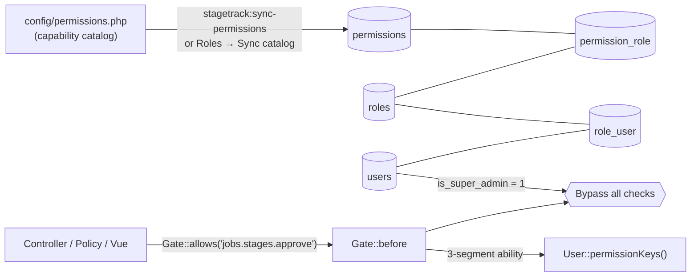
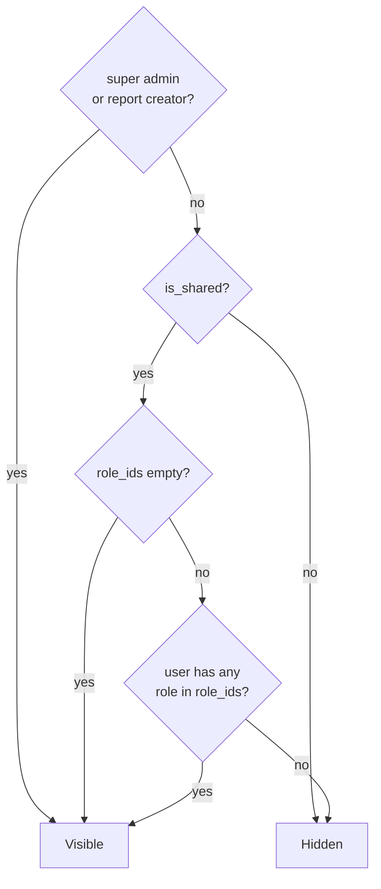

# Permissions & Access Control

StageTrack uses a **fully database-driven** role-based access control model. There are **no hard-coded roles** anywhere in the code base: administrators create as many roles as they need in *Administration → Roles* and attach any combination of capabilities from the permission catalog.



## 1. Catalog structure

`config/permissions.php` is only a **catalog** — the list of every capability the application can check. It never assigns capabilities to anyone. Its shape:

```php
return [
    '{module}' => [
        'label' => 'Human label',
        'resources' => [
            '{resource}' => ['label' => 'Human label', 'actions' => ['view', 'create', ...]],
        ],
    ],
];
```

Each `module.resource.action` triple becomes one row in `permissions` (`key`, `module`, `resource`, `action`, `label`). Synchronisation is idempotent (upsert by `key`) and runs:

- during the setup wizard (step "migrate + seed permission catalog"),
- after every in-app update (UpdateManager runs migrations and the sync),
- on demand via *Administration → Roles → Sync catalog* or `php artisan stagetrack:sync-permissions`.

Removing an entry from the catalog does not silently drop grants from roles until the next sync prunes obsolete keys; the sync reports added/removed keys.

### Standard actions

| Action | Meaning |
|---|---|
| `view` | See lists/detail pages for the resource |
| `create` | Create new records |
| `edit` | Modify records |
| `delete` | Delete / archive records |
| `export` | Download CSV/XLSX/PDF, print labels |
| `approve` | Perform approval-gated transitions (job approval, overbooking override, damage write-off…) |
| `admin` | Elevated, destructive or bulk operations (bulk import, run migrations, restore backups, apply updates…) |

## 2. Permission catalog (130 keys)

### Inventory (`inventory`)

| Key | Resource | Action |
|---|---|---|
| `inventory.products.view` | Products | view |
| `inventory.products.create` | Products | create |
| `inventory.products.edit` | Products | edit |
| `inventory.products.delete` | Products | delete |
| `inventory.products.export` | Products | export |
| `inventory.products.admin` | Products | admin |
| `inventory.categories.view` | Categories & manufacturers | view |
| `inventory.categories.create` | Categories & manufacturers | create |
| `inventory.categories.edit` | Categories & manufacturers | edit |
| `inventory.categories.delete` | Categories & manufacturers | delete |
| `inventory.locations.view` | Locations | view |
| `inventory.locations.create` | Locations | create |
| `inventory.locations.edit` | Locations | edit |
| `inventory.locations.delete` | Locations | delete |
| `inventory.stock.view` | Stock adjustments | view |
| `inventory.stock.edit` | Stock adjustments | edit |
| `inventory.stock.approve` | Stock adjustments | approve |
| `inventory.availability.view` | Availability Explorer | view |
| `inventory.availability.export` | Availability Explorer | export |

### Assets (`assets`)

| Key | Resource | Action |
|---|---|---|
| `assets.assets.view` | Serialized assets | view |
| `assets.assets.create` | Serialized assets | create |
| `assets.assets.edit` | Serialized assets | edit |
| `assets.assets.delete` | Serialized assets | delete |
| `assets.assets.export` | Serialized assets | export |
| `assets.assets.admin` | Serialized assets | admin |
| `assets.status.edit` | Asset status changes | edit |
| `assets.status.approve` | Asset status changes | approve |
| `assets.labels.view` | Barcode & QR labels | view |
| `assets.labels.export` | Barcode & QR labels | export |

### Contacts (`contacts`)

| Key | Resource | Action |
|---|---|---|
| `contacts.contacts.view` | Contacts & organizations | view |
| `contacts.contacts.create` | Contacts & organizations | create |
| `contacts.contacts.edit` | Contacts & organizations | edit |
| `contacts.contacts.delete` | Contacts & organizations | delete |
| `contacts.contacts.export` | Contacts & organizations | export |

### Jobs (`jobs`)

| Key | Resource | Action |
|---|---|---|
| `jobs.jobs.view` | Jobs | view |
| `jobs.jobs.create` | Jobs | create |
| `jobs.jobs.edit` | Jobs | edit |
| `jobs.jobs.delete` | Jobs | delete |
| `jobs.jobs.export` | Jobs | export |
| `jobs.jobs.approve` | Jobs | approve |
| `jobs.jobs.admin` | Jobs | admin |
| `jobs.items.view` | Equipment allocations | view |
| `jobs.items.create` | Equipment allocations | create |
| `jobs.items.edit` | Equipment allocations | edit |
| `jobs.items.delete` | Equipment allocations | delete |
| `jobs.stages.edit` | Lifecycle transitions | edit |
| `jobs.stages.approve` | Lifecycle transitions | approve |
| `jobs.files.view` | Files & notes | view |
| `jobs.files.create` | Files & notes | create |
| `jobs.files.delete` | Files & notes | delete |

### Reservations (`reservations`)

| Key | Resource | Action |
|---|---|---|
| `reservations.reservations.view` | Reservations & holds | view |
| `reservations.reservations.create` | Reservations & holds | create |
| `reservations.reservations.edit` | Reservations & holds | edit |
| `reservations.reservations.delete` | Reservations & holds | delete |
| `reservations.reservations.export` | Reservations & holds | export |
| `reservations.reservations.approve` | Reservations & holds | approve |
| `reservations.overbooking.approve` | Override overbooking conflicts | approve |

### Warehouse (`warehouse`)

| Key | Resource | Action |
|---|---|---|
| `warehouse.picking.view` | Picking | view |
| `warehouse.picking.edit` | Picking | edit |
| `warehouse.prep.view` | Prep | view |
| `warehouse.prep.edit` | Prep | edit |
| `warehouse.staging.view` | Staging | view |
| `warehouse.staging.edit` | Staging | edit |
| `warehouse.checkout.view` | Check out | view |
| `warehouse.checkout.edit` | Check out | edit |
| `warehouse.returns.view` | Returns | view |
| `warehouse.returns.edit` | Returns | edit |
| `warehouse.damage.view` | Damage processing | view |
| `warehouse.damage.edit` | Damage processing | edit |
| `warehouse.damage.approve` | Damage processing | approve |
| `warehouse.display.view` | Fullscreen display | view |

### Maintenance (`maintenance`)

| Key | Resource | Action |
|---|---|---|
| `maintenance.records.view` | Maintenance records | view |
| `maintenance.records.create` | Maintenance records | create |
| `maintenance.records.edit` | Maintenance records | edit |
| `maintenance.records.delete` | Maintenance records | delete |
| `maintenance.records.export` | Maintenance records | export |
| `maintenance.records.approve` | Maintenance records | approve |

### Documents (`documents`)

| Key | Resource | Action |
|---|---|---|
| `documents.documents.view` | Generated documents | view |
| `documents.documents.create` | Generated documents | create |
| `documents.documents.delete` | Generated documents | delete |
| `documents.documents.export` | Generated documents | export |
| `documents.templates.view` | Template designer | view |
| `documents.templates.create` | Template designer | create |
| `documents.templates.edit` | Template designer | edit |
| `documents.templates.delete` | Template designer | delete |
| `documents.templates.admin` | Template designer | admin |

### Reporting (`reporting`)

| Key | Resource | Action |
|---|---|---|
| `reporting.reports.view` | Reports | view |
| `reporting.reports.create` | Reports | create |
| `reporting.reports.edit` | Reports | edit |
| `reporting.reports.delete` | Reports | delete |
| `reporting.reports.export` | Reports | export |
| `reporting.reports.admin` | Reports | admin |
| `reporting.schedules.view` | Scheduled delivery | view |
| `reporting.schedules.create` | Scheduled delivery | create |
| `reporting.schedules.edit` | Scheduled delivery | edit |
| `reporting.schedules.delete` | Scheduled delivery | delete |
| `reporting.dashboard.view` | Dashboard widgets | view |

### Rules (`rules`)

| Key | Resource | Action |
|---|---|---|
| `rules.rules.view` | Dependency & validation rules | view |
| `rules.rules.create` | Dependency & validation rules | create |
| `rules.rules.edit` | Dependency & validation rules | edit |
| `rules.rules.delete` | Dependency & validation rules | delete |

### Settings (`settings`)

| Key | Resource | Action |
|---|---|---|
| `settings.general.view` | Organization settings | view |
| `settings.general.edit` | Organization settings | edit |
| `settings.custom_fields.view` | Custom fields | view |
| `settings.custom_fields.create` | Custom fields | create |
| `settings.custom_fields.edit` | Custom fields | edit |
| `settings.custom_fields.delete` | Custom fields | delete |
| `settings.security.view` | Security policies | view |
| `settings.security.edit` | Security policies | edit |

### Administration (`admin`)

| Key | Resource | Action |
|---|---|---|
| `admin.users.view` | Users | view |
| `admin.users.create` | Users | create |
| `admin.users.edit` | Users | edit |
| `admin.users.delete` | Users | delete |
| `admin.users.export` | Users | export |
| `admin.users.admin` | Users | admin |
| `admin.roles.view` | Roles & permissions | view |
| `admin.roles.create` | Roles & permissions | create |
| `admin.roles.edit` | Roles & permissions | edit |
| `admin.roles.delete` | Roles & permissions | delete |
| `admin.audit.view` | Audit log | view |
| `admin.audit.export` | Audit log | export |
| `admin.system.view` | System maintenance (migrations, cache, health, storage) | view |
| `admin.system.admin` | System maintenance (migrations, cache, health, storage) | admin |
| `admin.backups.view` | Backups & restore | view |
| `admin.backups.create` | Backups & restore | create |
| `admin.backups.delete` | Backups & restore | delete |
| `admin.backups.admin` | Backups & restore | admin |
| `admin.logs.view` | Application logs | view |
| `admin.updates.view` | Application updates | view |
| `admin.updates.admin` | Application updates | admin |


### Notable gated operations

| Operation | Permission required |
|---|---|
| Move a job into **Approved** or **Reserved** (`JobStage::requiresApproval()`) | `jobs.stages.approve` (plus `jobs.stages.edit` for any transition) |
| Save allocations that would overbook while `reservations.block_overbooking` is on | `reservations.overbooking.approve` |
| Edit allocations after a job has left Prep (`JobStage::allowsAllocationEdits()` false) | `jobs.jobs.admin` |
| Write off damaged equipment from the warehouse damage queue | `warehouse.damage.approve` |
| Close / write off a maintenance record | `maintenance.records.approve` |
| Bulk stock adjustments | `inventory.stock.approve` |
| Clear config, route, or compiled view caches | `admin.system.admin` (viewing the system page requires `admin.system.view`) |
| Restore a backup | `admin.backups.admin` |
| Upload & apply an update | `admin.updates.admin` |
| Edit code-mode templates / raw `html` blocks | `documents.templates.admin` |
| See and manage every report regardless of visibility | `reporting.reports.admin` |
| Privileged user administration (reset 2FA, unlock accounts, revoke sessions, force password reset) | `admin.users.admin` |

## 3. How authorization is evaluated

`App\Providers\AppServiceProvider::boot()` registers a single `Gate::before` callback:

```php
Gate::before(function (User $user, string $ability) {
    if ($user->is_super_admin) {
        return true;                                   // 1. super admin bypass
    }
    if (substr_count($ability, '.') === 2) {           // 2. "module.resource.action"
        return $user->hasPermission($ability) ?: null; //    grant, or fall through
    }
    return null;                                       // 3. other abilities → policies
});
```

1. **Super administrators** (`users.is_super_admin = 1`) pass every check.
2. Any ability with exactly three dot-separated segments is resolved against the union of permission keys of all the user's roles (`User::permissionKeys()` — one query joining `role_user → permission_role → permissions`, memoised per request).
3. If the user lacks the key, `null` is returned and Laravel continues with normal gate/policy resolution. Catalog keys are not defined as individual gates, so they resolve to **denied**. Abilities that are not catalog keys (e.g. policy methods such as `update` on a `Note`, used for "authors may edit their own notes") are decided by the module's Policy classes, which themselves call `$user->hasPermission(...)` for the catalog part of the decision.

Usage everywhere is uniform:

```php
// routes.php
Route::get('/jobs', [JobController::class, 'index'])->middleware('can:jobs.jobs.view');

// controller / service
Gate::authorize('jobs.stages.approve');

// FormRequest
public function authorize(): bool { return $this->user()->can('inventory.products.edit'); }
```

### Frontend

`HandleInertiaRequests` shares `auth.permissions` with every page: `['*']` for super admins, otherwise the flat list of keys. The Vue composable `can('jobs.jobs.create')` hides buttons, menu items and sidebar sections the user cannot use. **The frontend check is cosmetic** — the server always re-authorizes.

## 4. Super administrator

- Created by the setup wizard (step "super admin"); further super admins can be toggled by an existing super admin in *Administration → Users*.
- `security.require_two_factor_for_admins` (default **true**) requires super admins to verify TOTP, a recovery code, or a passkey in the current session before using the app (`EnforceSecurityPolicy`). An enrolled factor alone is not proof; remembered and pre-existing sessions without proof must sign in again.
- The last remaining active super admin cannot be deactivated, demoted or deleted.

## 5. Example roles (illustrative only — not created by StageTrack)

The following are **examples an administrator might create**. Nothing in the application seeds or references these names.

| Example role | Typical grants |
|---|---|
| **Production Manager** | all `jobs.*`, all `reservations.*` incl. `reservations.overbooking.approve`, `inventory.*.view`, `inventory.availability.*`, `contacts.contacts.*`, `documents.documents.*`, `documents.templates.view`, `reporting.reports.view/create/export`, `reporting.dashboard.view`, `rules.rules.view` |
| **Shop Head** (Electrics / Audio) | `inventory.products.*`, `inventory.categories.*`, `inventory.locations.*`, `inventory.stock.*`, `assets.*`, `maintenance.records.*`, all `warehouse.*`, `jobs.jobs.view`, `jobs.items.*`, `jobs.stages.edit`, `rules.rules.*`, `documents.templates.*`, `reporting.reports.*` |
| **Student Crew** | `inventory.products.view`, `assets.assets.view`, `inventory.availability.view`, `jobs.jobs.view`, `jobs.items.view`, `warehouse.picking.*`, `warehouse.prep.*`, `warehouse.staging.*`, `warehouse.returns.*`, `warehouse.damage.view/edit`, `warehouse.display.view`, `maintenance.records.view/create` |
| **Faculty Viewer** | `*.view` for inventory, assets, jobs, reservations, maintenance, documents; `reporting.reports.view`, `reporting.dashboard.view` |
| **Warehouse Display** (kiosk account) | `warehouse.display.view` only |

Roles flagged `is_default` are attached automatically to newly created users.

## 6. Report visibility

Reports add a second layer on top of `reporting.reports.view` (`Report::isVisibleTo()`):



Holders of `reporting.reports.admin` can manage all reports in the builder. Scheduled deliveries render the report as the schedule owner sees it.

## 7. Audit

- Every change to roles (`Role` is `Auditable`), role permissions and user role assignments is written to `audit_logs` with old/new values.
- Authentication events are recorded as audit events: `login`, `login.passkey`, `login.failed`, `logout`, `lockout`, `two_factor.enabled`, `two_factor.disabled`, `passkey.registered`, `passkey.removed`, `session.revoked`, `password.changed`.
- Approval-gated operations (stage approvals, overbooking overrides, write-offs, restores, updates) record the acting user and context.
- The audit log is viewable/exportable with `admin.audit.view` / `admin.audit.export`; sensitive attributes (`password`, `remember_token`, `two_factor_secret`, `two_factor_recovery_codes`) are never written because they are hidden attributes.
