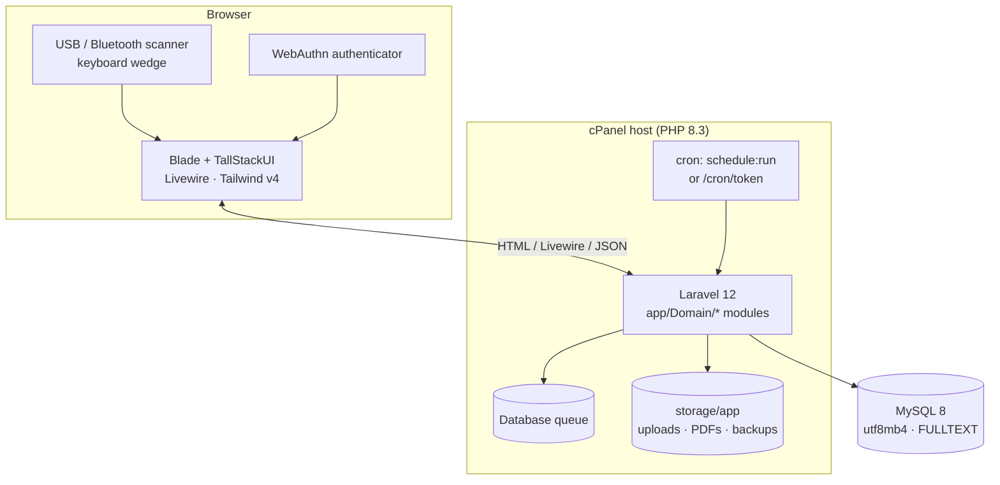

# StageTrack Enterprise — Documentation

Planning and architecture documentation for StageTrack Enterprise. It is a 1:1 workflow replacement for Current RMS, built for educational theatre programs, performing arts centers, university production departments, electrics and audio shops, event spaces and rental operations.

| Document | What it covers | Primary audience |
|---|---|---|
| [SRD.md](SRD.md) | Software requirements: purpose, scope, personas, glossary, numbered functional requirements (FR-INV-001 …), non-functional requirements, constraints, Current RMS parity matrix, acceptance criteria | Product, stakeholders, QA |
| [MODULES.md](MODULES.md) | Module map: dependency graph, responsibilities, key classes, pages and permissions per module. Workflow diagrams for the job lifecycle, availability, scanning, document rendering, reporting and login | Engineers |
| [DATABASE.md](DATABASE.md) | Every table with its columns, indexes and relations; indexing strategy; MySQL 8 specifics; morph map; full ER diagram | Engineers, DBAs |
| [API.md](API.md) | Every HTTP endpoint by module: method, path, route name, permission, parameters and response, with JSON examples | Engineers |
| [PERMISSIONS.md](PERMISSIONS.md) | Permission catalog (all keys), `Gate::before` resolution, super admin, example roles, report visibility, audit | Admins, engineers |
| [DECISIONS.md](DECISIONS.md) | Architecture decision records (ADRs) | Engineers, maintainers |
| [ROADMAP.md](ROADMAP.md) | Phases, milestones, v1.0 scope, v1.1+ ideas | Everyone |
| [INSTALLATION.md](INSTALLATION.md) | cPanel install, setup wizard, cron, configuration, backups, updates, troubleshooting, local development | Admins, developers |

## Reading paths

- **New engineer:** read [DECISIONS](DECISIONS.md), then [MODULES](MODULES.md), [DATABASE](DATABASE.md) and [API](API.md).
- **Installing on cPanel:** read [INSTALLATION](INSTALLATION.md), then [PERMISSIONS § example roles](PERMISSIONS.md).
- **Evaluating against Current RMS:** read the [SRD parity matrix](SRD.md#8-current-rms-workflow-parity-matrix), then the [ROADMAP](ROADMAP.md).

## System at a glance

## Conventions used in these docs

- Permission keys look like `module.resource.action` (see [PERMISSIONS.md](PERMISSIONS.md)).
- Module pages are Blade views under `resources/views`; interactive widgets use Livewire or small Alpine.js behaviors alongside TallStackUI components.
- Classes marked † in MODULES.md exist in the code. Unmarked classes are part of the agreed design. If code and docs disagree, the code is correct.
- Diagrams are written in Mermaid and render on GitHub.
