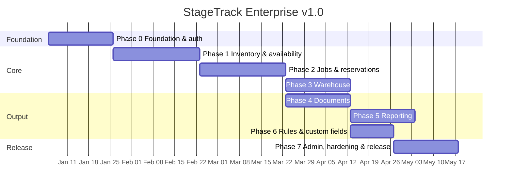

# Development Roadmap

StageTrack Enterprise is delivered in phases. Phases 0–7 constitute **v1.0**; later items are candidates for v1.1+. Each phase ends with green unit/feature tests and a demo.

## Phase 0 — Foundation

- Laravel 12 + Inertia 2 + Vue 3 + TypeScript + Tailwind v4 scaffold; Ziggy.
- Domain module structure + `ModuleServiceProvider` (route & command auto-registration).
- Core migrations (all tables in [DATABASE.md](DATABASE.md)); morph map.
- Settings repository with defaults & cache.
- Permission catalog + sync command; `Gate::before`; super admin.
- Authentication: username/email login, lockout, password policy, TOTP + recovery codes, passkeys, sessions list/revoke, password reset, `EnforceSecurityPolicy`.
- `Auditable`, `Searchable`, `HasCustomFields`, `HasNotesAndAttachments` traits.
- App shell: collapsible sidebar, top bar, ⌘K palette stub, dark mode, toasts, keyboard shortcut manager.
- Setup wizard + `EnsureApplicationInstalled`.

**Exit:** a fresh install via `/setup`, super admin signs in with 2FA/passkey, creates a role and a user.

## Phase 1 — Inventory & availability

- Products, categories, manufacturers, tags, images, accessories, locations tree, bulk stock levels.
- Assets (bulk create, status history, condition reports), barcode/QR label PDFs.
- Pure `AvailabilityCalculator` (sweep-line peak, sources) + `AvailabilityService` (batched loading).
- Availability Explorer with drill-down drawers and timeline.
- Contacts.

**Exit:** NFR-PERF-001 benchmark (50k assets) passes; acceptance criterion 4.

## Phase 2 — Jobs & reservations

- Job CRUD, 11-stage lifecycle rail, stage history, approval gating.
- Allocations with sections, required/spare/pull, accessory auto-expansion (`ceil`), drag ordering.
- `ReservationService` projection (tentative/confirmed/released), standalone holds.
- `ConflictDetector` + overbooking override.
- Job calendar, notes & attachments.

**Exit:** acceptance criteria 2, 3, 5, 6, 7.

## Phase 3 — Warehouse

- Pure `ScanProcessor` (pick, prep, stage, checkout, return, damage, lookup), `WarehouseService` applying effects transactionally.
- Scan workspace (always-focused input, progress panel), fullscreen display, WebAudio tones.
- `scan_events` log, damage → maintenance record.
- Maintenance module (records, queue, status workflow, asset status sync).

**Exit:** acceptance criterion 8; a 200-item pick completed with a USB scanner.

## Phase 4 — Documents

- Safe template language (`ExpressionParser`, `TemplateRenderer`, `SafeString`) with exhaustive unit tests.
- `BlockCompiler` + visual designer (drag blocks, properties panel) and code editor.
- Live preview (debounced POST → sandboxed iframe), sample data picker.
- `PullSheetBuilder` and document data builders per entity; dompdf PDF; `generated_documents` snapshots.
- Default templates for all 13 types.

**Exit:** acceptance criterion 10.

## Phase 5 — Reporting

- `ReportSourceRegistry` (10 sources, whitelisted columns + custom fields), `ReportRunner`.
- Builder UI (columns, filters, group, aggregates, sort, chart), charts.
- Exports: CSV (streamed), XLSX (own writer), PDF.
- Dashboard widgets; scheduled delivery (`reports:deliver-scheduled`).

**Exit:** acceptance criterion 11.

## Phase 6 — Rules & custom fields

- `RuleEvaluator` (requires, requires_any, max_quantity, min_spares; pull/required basis) + accessory completeness.
- No-code rule builder with test panel; job validation panel + "add missing".
- Custom field definitions UI, `CustomFieldValidator`, form renderer component, list columns, report integration, search integration.

**Exit:** acceptance criterion 9.

## Phase 7 — Administration, hardening & release

- `MigrationManager`, `BackupManager` (PDO dump + zip, restore, schedule, retention), `LogViewer`, `HealthChecker`, `StorageInspector`, `CacheManager`, `UpdateManager` (feed, upload, zip-slip guard, maintenance mode, migrate).
- HTTP cron endpoint; scheduler entries (reports, backups, queue).
- Global search ranking; search rebuild.
- Accessibility audit (axe + manual keyboard/screen reader), performance pass, security review (CSRF, authz matrix tests, upload validation, template fuzzing).
- Release packaging: `composer install --no-dev -o`, `npm run build`, zip with `vendor/` and `public/build/`.
- Documentation (this folder).

**Exit:** all acceptance criteria in [SRD §9](SRD.md#9-acceptance-criteria).

## What ships in v1.0

| Area | Delivered |
|---|---|
| Inventory | products, categories, manufacturers, tags, images, accessories, locations tree, bulk stock, CSV export |
| Assets | serialized units, status history, condition reports, labels |
| Availability | calculator with sources & peak, explorer, conflict detection, tentative handling |
| Jobs | 11-stage lifecycle with approvals, sections, required/spare/pull, accessories, notes/files, calendar |
| Reservations | job projection + standalone holds |
| Warehouse | 7 scan modes, fullscreen display, sounds, scan log |
| Maintenance | records, workflow, damage capture |
| Rules | no-code builder, 4 check types, accessory completeness |
| Documents | 13 types, visual + code designer, live preview, PDF, snapshots |
| Reporting | 10 sources, builder, charts, CSV/XLSX/PDF, dashboard, schedules |
| Custom fields | 14 types on 8 entities, reportable |
| Security | username/email, TOTP, passkeys, sessions, policies, audit |
| Admin | setup wizard, users/roles, migrations, backups/restore, logs, health, storage, cache, updates |
| UX | ⌘K, shortcuts, dark mode, responsive, WCAG 2.2 AA |

## v1.1+ ideas

| Idea | Notes |
|---|---|
| **Offline warehouse PWA** | Service worker + IndexedDB scan queue; replays scans with conflict resolution when back online. |
| **Label printer integration** | Direct ZPL/EPL for Zebra, Brother QL via browser print or WebUSB; label template designer. |
| **Accounting sync** | Push invoices/customers to QuickBooks Online / Xero; tax rates; payments status. |
| **Public API tokens** | Personal access tokens with permission-scoped abilities, REST `/api/v1`, webhooks (job stage changed, scan). |
| **Seasons / projects** | Group jobs into seasons with shared budgets and roll-up availability. |
| **Crew & labour** | Crew calls, hours, student timesheets for course credit. |
| **Kits / cases** | Physical case contents with nested scanning ("scan the case, get 6 fixtures"). |
| **Multi-site transfers** | Inter-location transfer jobs and in-transit status. |
| **Sub-rentals** | Cross-hire from vendors to cover shortages, with costs. |
| **Notifications** | Email/in-app digests: overdue returns, maintenance due, shortages. |
| **SSO** | SAML/OIDC for universities (Azure AD, Google Workspace, Shibboleth). |
| **i18n** | Translatable UI strings; locale-aware documents. |
| **Utilisation analytics** | Asset ROI, idle-time heatmaps. |
| **RFID** | Bulk reads via UHF RFID gates. |
